·Java Modernization Studio UX Audit: Recommendations
for a Clearer, More Agentic Experience

Author: jaeyong lee

Audit Date: 2026.09.06

1.  Information Architecture

First screen shown when the Java Modernization Studio launches

### Images from page 1

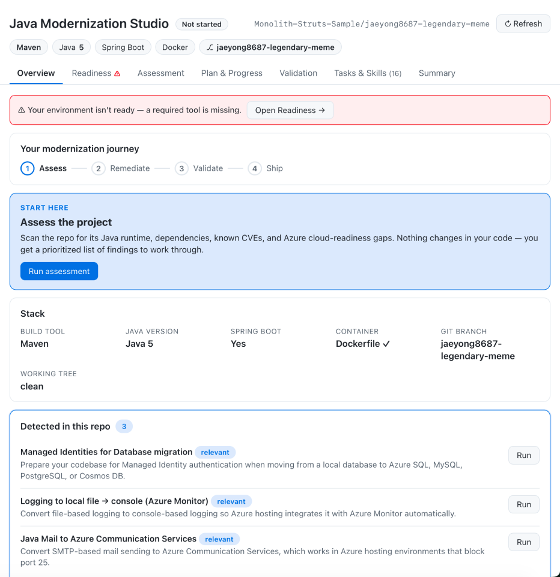

Analysis of the current information architecture

The current information architecture is harder to understand than it needs to be. It
duplicates information, competes for attention, and behaves inconsistently with adjacent
modernization experiences. A simpler structure organized around the user's core jobs-to-
be-done - assessment, planning, and validation - would make the product easier to learn,
easier to navigate, and easier to trust.

-  Global menu for cross-cutting actions such as Autopilot and Refresh.

### Images from page 2

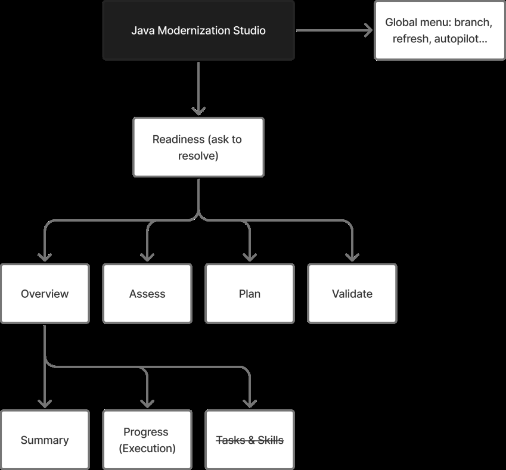

-  The primary navigation should map directly to the user's core jobs-to-be-done:

Assess, Plan, and Validate.

-  Keep execution and progress continuously visible through an overview that surfaces

the current stage and next action.

-  Use the overview to provide a concise status summary, including completed work,

current progress, blockers, and the next recommended step.

2.  Information overload

The current surface exposes too much detail at once and makes the primary message and
action difficult to find. Information should be progressively disclosed and grouped by

### Images from page 3

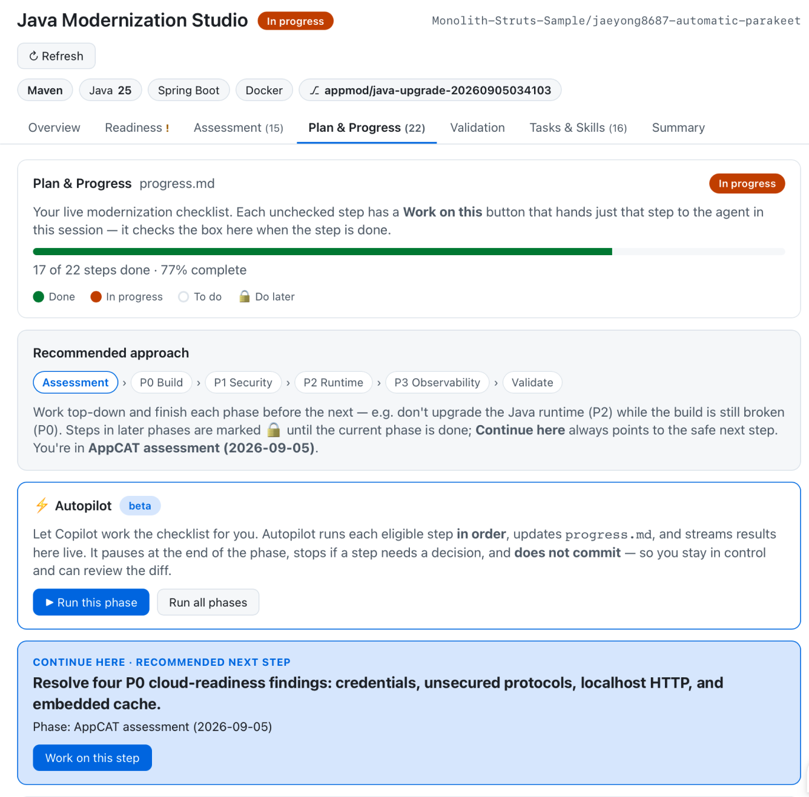

context. For example, Autopilot can be represented by a single icon in the global menu,
while "Continue here" can be integrated into the overall progress indicator instead of
appearing as a separate card.

3.  Product naming: Java Modernization Studio

This is a lower-priority change, but the product name should align with the naming strategy
used across modernization surfaces. "Modernization Canvas," for example, would be
clearer and more consistent.

4.  Resolve dependencies before execution begins

The current experience warns users about missing dependencies and sends them to the
Readiness page, even though no modernization task can succeed until those
dependencies are resolved. This creates avoidable blockers and makes users do setup
work after they have already entered the main workflow. The product should detect and
resolve required dependencies before the user enters the main experience, or clearly gate
the workflow behind a guided readiness step.

Readiness warning banner and tab icon

### Images from page 4

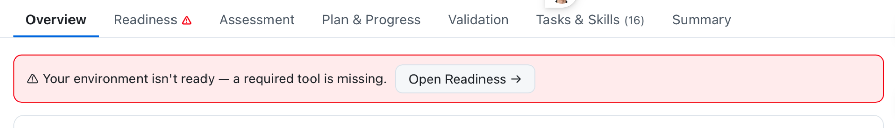

Readiness detail page

Readiness should be a single, guided entry point that detects missing prerequisites and
resolves them proactively. The current "Help me set up ..." action provides instructions, but
it does not complete the setup. The agent should make and explain the required decisions,
then perform safe actions - such as installing Maven - rather than merely displaying
terminal commands.

5.  Remove duplicate information

Several elements repeat the same information without adding context or helping the user
decide what to do next. Removing these duplicates would reduce noise and strengthen
hierarchy.

### Images from page 5

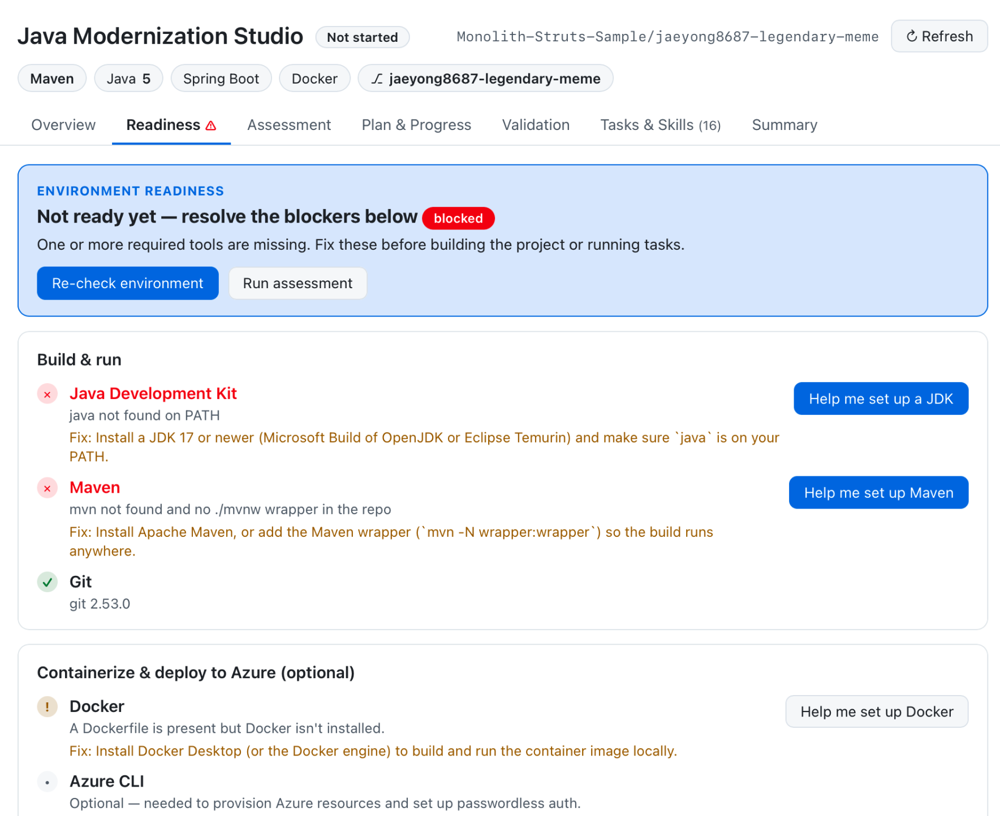

Labels in the global view

Stack card under the overview

6.  Trigger the canvas from the user's intent

The primary entry point should be the conversation, not a manually opened canvas. In the
GitHub Copilot app, users will naturally say, "Modernize my Java application," rather than
type the product's internal name or discover a plug-in surface themselves. When the agent
detects that intent, it should open and drive the Modernization Canvas automatically. This
is essential for the top of the funnel: if users must know the exact surface name or open it
manually, many will never reach the experience they installed.

Start with a natural request such as: "I would like to modernize my Java application."

### Images from page 6

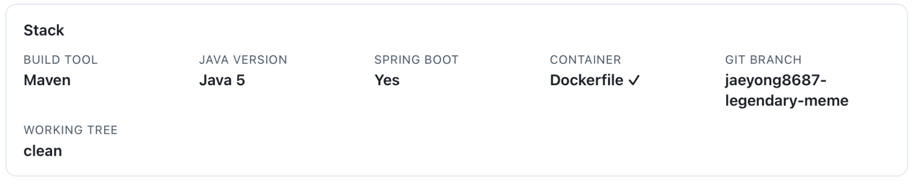

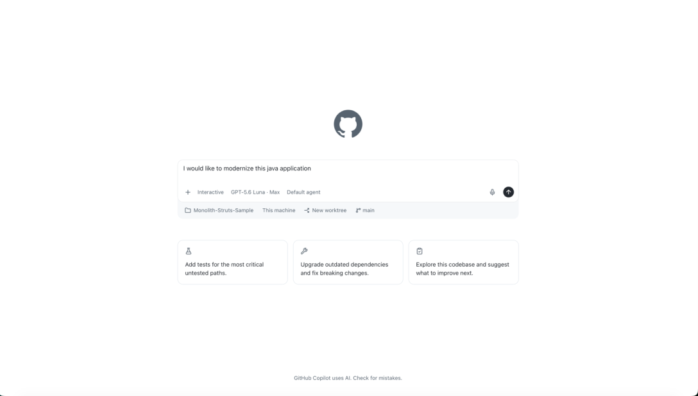

The default GitHub Copilot app agent does not trigger the Modernization Canvas during
setup.

Users can continue executing modernization tasks without the Modernization Canvas.

The canvas opens only when the prompt contains a specific phrase such as "Java
Modernization Studio," which is unlikely in a natural conversation.

For comparison, the Foundry canvas in the GitHub Copilot app behaves as follows:

### Images from page 7

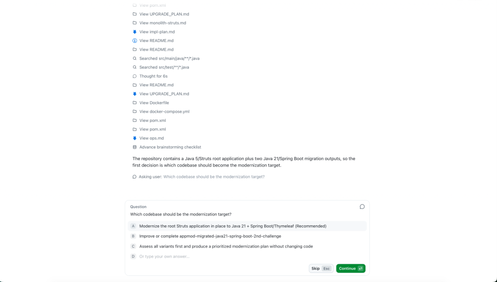

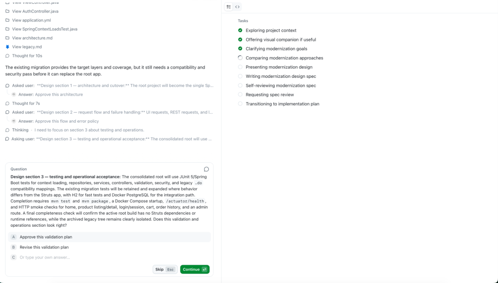

Start with a simple prompt: "Let's build a Foundry agent."

The agent recognizes the intent, opens the agent-builder canvas, and guides the user
through setup.

7.  Synchronize modernization progress automatically

### Images from page 8

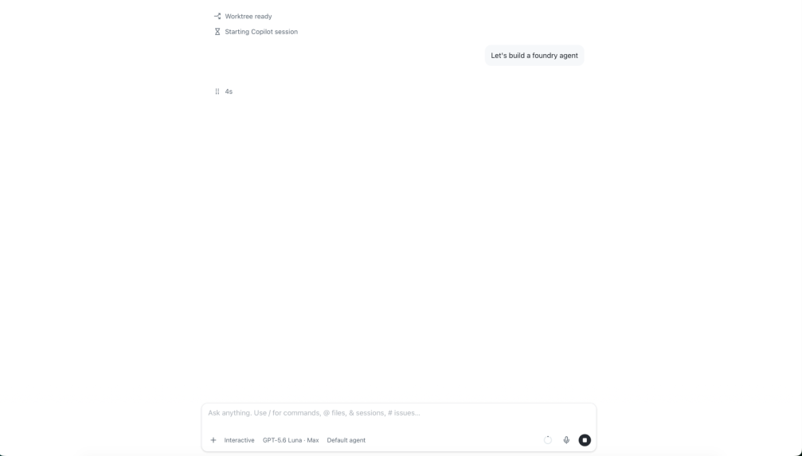

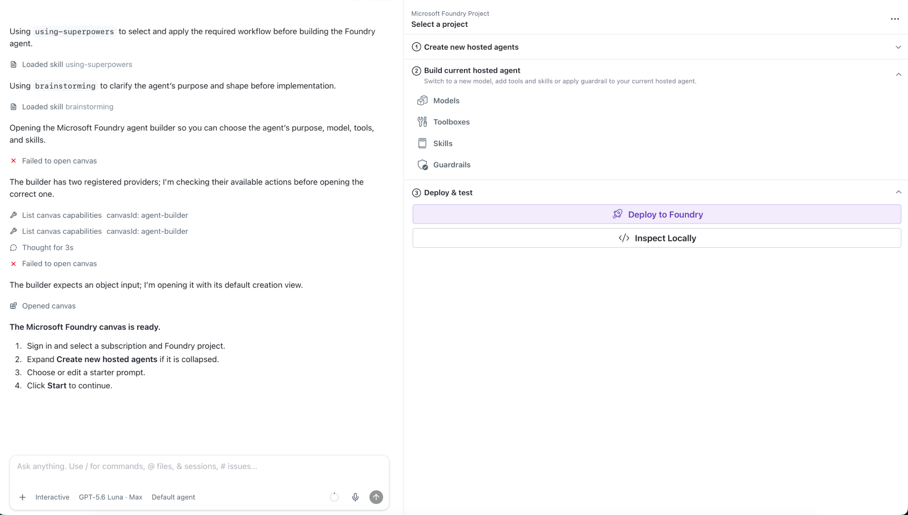

The agent runs the assessment and generates artifacts, but the canvas does not update
automatically.

Modernization completes without a visible summary

### Images from page 9

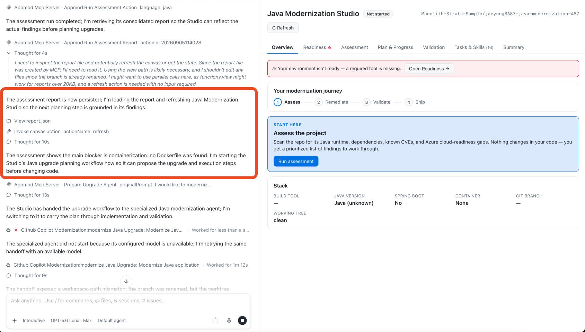

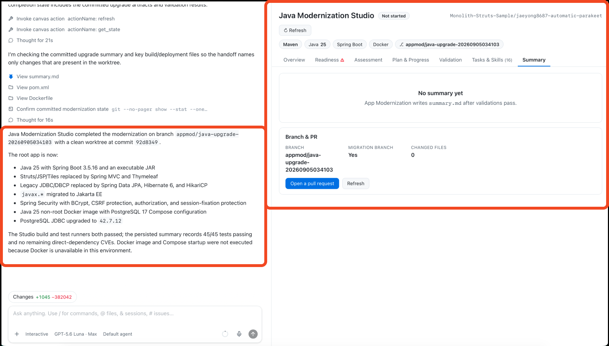

Users expect the canvas to reflect progress as soon as work is completed. Today, they must
reopen the canvas - and even Refresh may not show the latest state - to see updates. The
canvas should subscribe to the active session's progress and automatically refresh its
status, results, and next actions.

When asked why the canvas was stale, the agent returned a long explanation about branch
state and scanner recognition, repeated the same explanation, and still did not update the
canvas. This is evidence of the visibility problem: the user received implementation detail
instead of a current, trustworthy product state.

The same stale-state problem occurs after dependency installation.

### Images from page 10

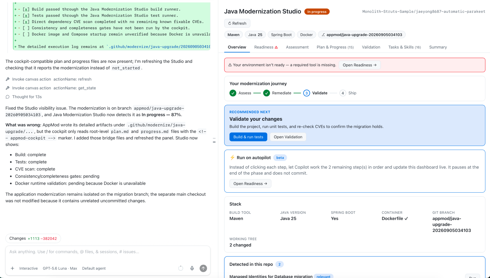

Dependencies are installed, but the canvas does not reflect the updated state.

8.  Do not expose raw prompts in the chat

### Images from page 11

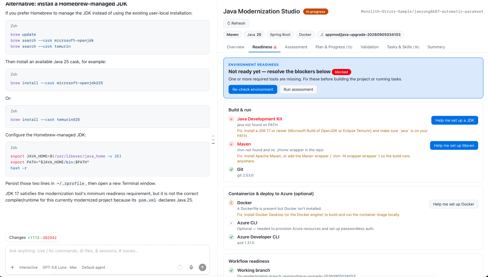

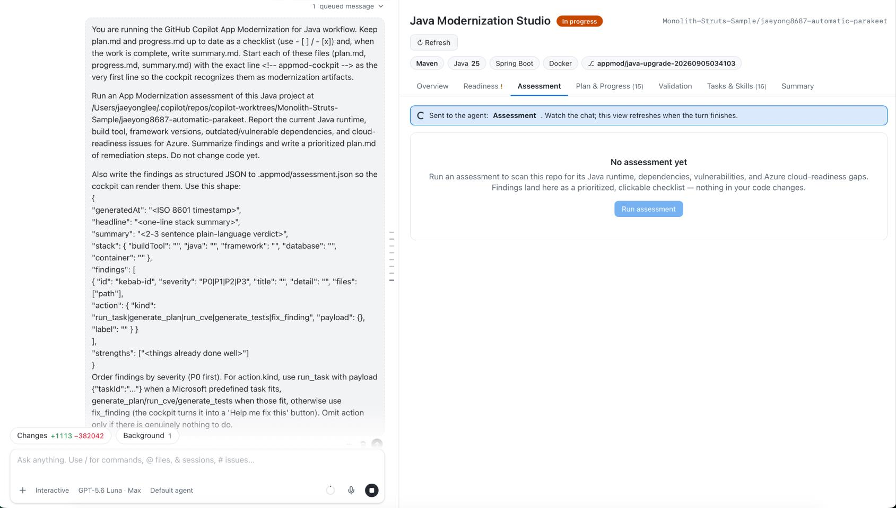

The product should send a short, abstract user-facing message that triggers the detailed
instruction behind the scenes. Exposing a long, raw prompt is confusing, easy to copy, and
makes the product's value feel fragile. A concise prompt preserves the experience while
allowing the underlying workflow to evolve.

9.  Provide assessment configuration

Assessment supports multiple configuration options depending on the scenario, but
the Modernization Canvas runs it with no opportunity for user input. Users should be
able to review and adjust the relevant scope, target, and options before execution.

10. Avoid internal product names in customer-facing UI

"AppCAT" is an internal product name and should not appear on customer-facing surfaces.
The term is unfamiliar to users, adds unnecessary cognitive load, and conflicts with the
naming direction already used across modernization experiences. Use a clear user-facing
term such as "Assessment" consistently in the canvas, chat, and generated artifacts.

Use a user-facing title for the assessment plan

### Images from page 12

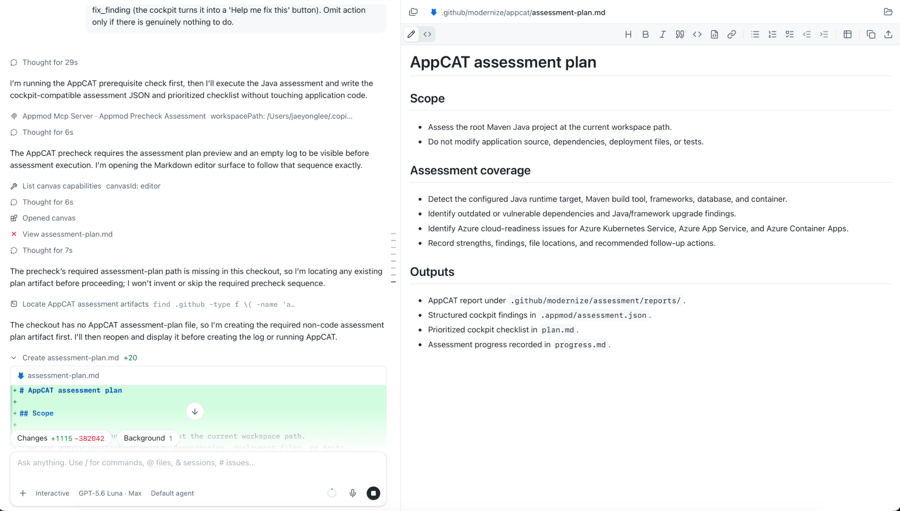

The agent also references "AppCAT" in chat responses. The internal name should be
replaced with the same user-facing terminology used throughout the experience.

11. Align the assessment report with existing modernization experiences

### Images from page 13

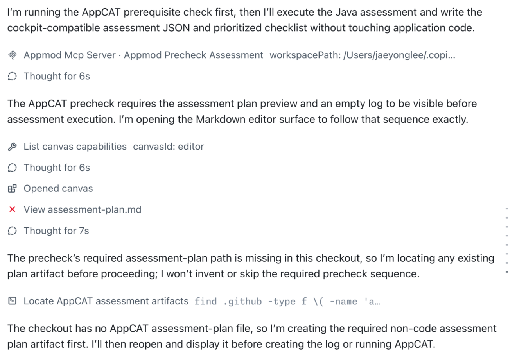

Modernization tools already provide a mature assessment-report experience across
Modernize CLI, Mission Control, and the VS Code extension. The Modernization Canvas
should reuse that information architecture, terminology, and interaction model instead of
introducing a parallel design. Consistency will reduce learning time, make results easier to
compare, and lower the cost of maintaining multiple surfaces.

12. Make task resolution clear

### Images from page 14

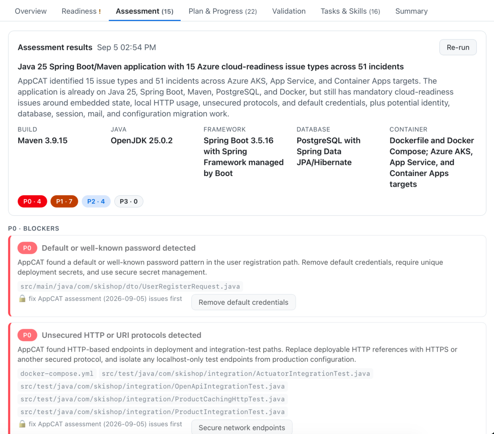

Assessment reports already group P0-P2 findings and expose actions for each problem.
The canvas should make that path immediate: show the issue, explain its impact, and
present the most relevant resolution.

The current "Specific task" and "Help me" actions do not communicate a clear difference
in value. Prefer one primary action that resolves the issue, or make the two paths explicitly
distinct - for example, "Fix it for me" versus "Explain and let me decide." The experience
should also support both targeted execution and running all recommended tasks,
matching the multi-task capability already available in the latest VS Code modernization
flow.

13. Make the plan editable

### Images from page 15

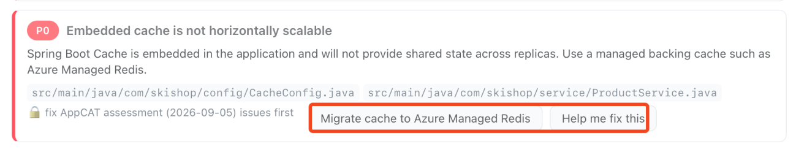

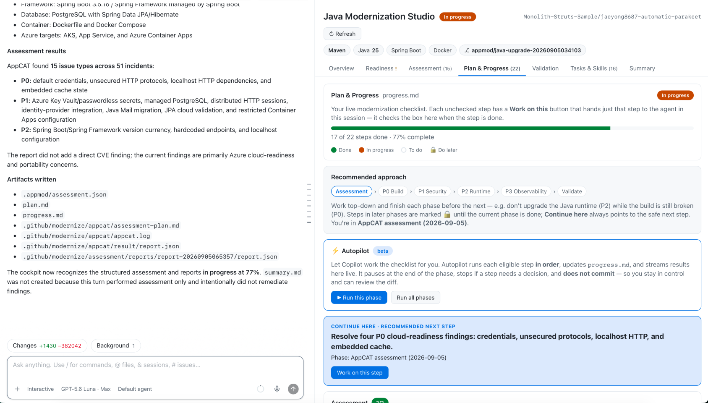

The planning phase currently assumes most decisions on the user's behalf and does not
provide a way to adapt the plan to business constraints. This is the moment for human-in-
the-loop control: let users review assumptions, change scope, opt out of defaults, and
approve the plan before execution.

14. Show accurate validation guidance

Build, unit tests, and CVE checks are complete, but the recommended next step still says
"Build & Unit Test." Validation guidance must reflect the actual state and surface only the
remaining actions.

15. Do not carry over the flat VS Code task list

### Images from page 16

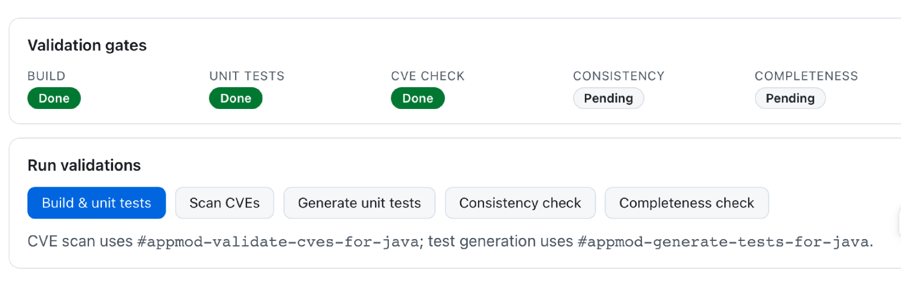

The VS Code extension retained a linear task list because users started from a UI and
needed to discover available actions. The GitHub Copilot app is already agentic, so the
same flat list is no longer the right model. The canvas should encourage users to run an
assessment and use its findings as the source of truth for contextual recommendations,
rather than presenting related and unrelated tasks together.

Remove the flat task list and show only tasks that are relevant to the assessment findings.

16. Manage skills through the native GitHub Copilot experience

Skills are a general capability that users already expect to manage through the GitHub
Copilot app. Because the app provides a native create, edit, and manage experience

### Images from page 17

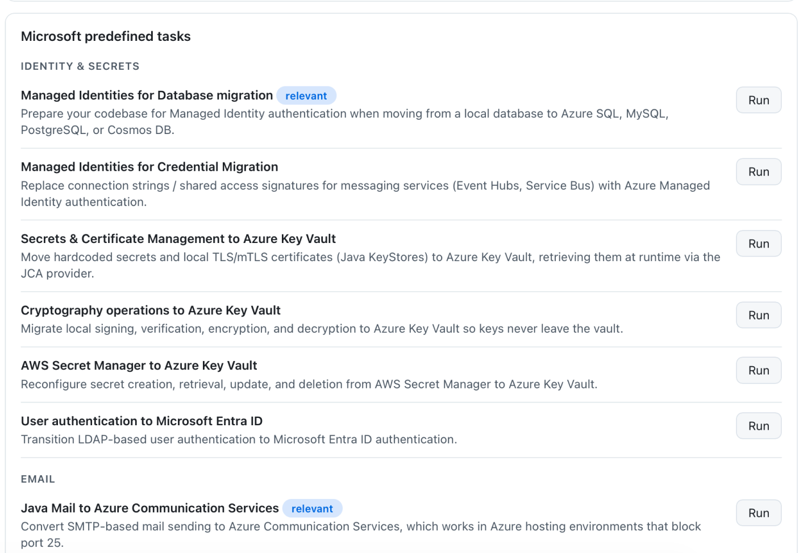

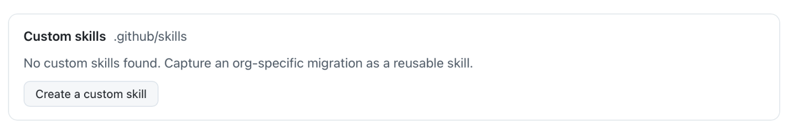

under .github/skills, the Modernization Canvas should not introduce a separate skills
feature.

GitHub Copilot app settings -> Customize -> Skills

Skills should be managed at the app or system level so they remain available outside the
Modernization Canvas. Remove the canvas-specific skills surface and link users to the
native skill-management experience instead.

### Images from page 18

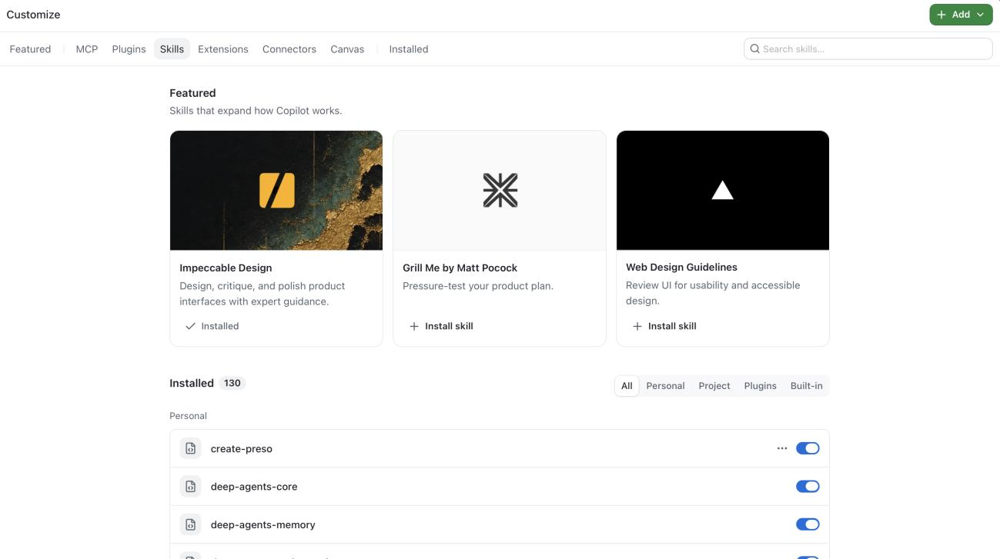
